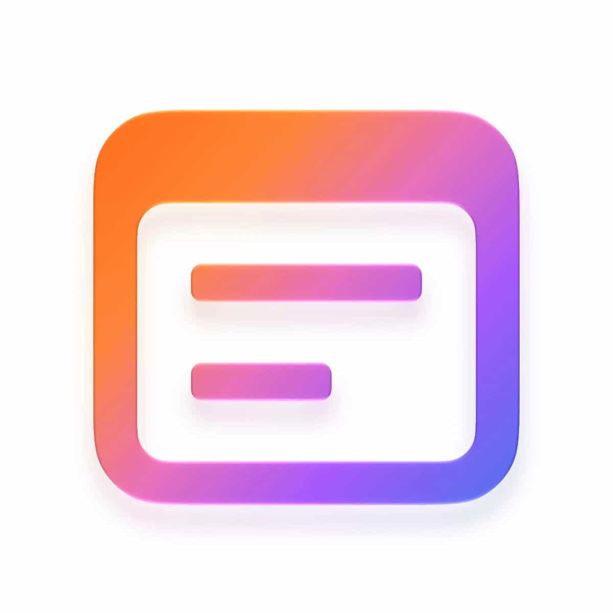
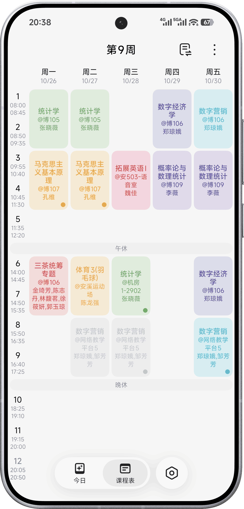
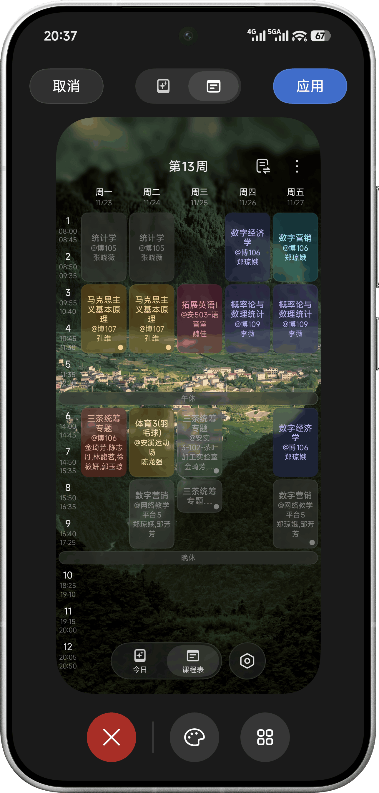
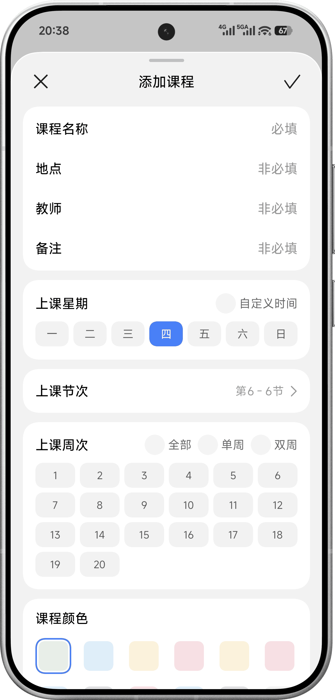
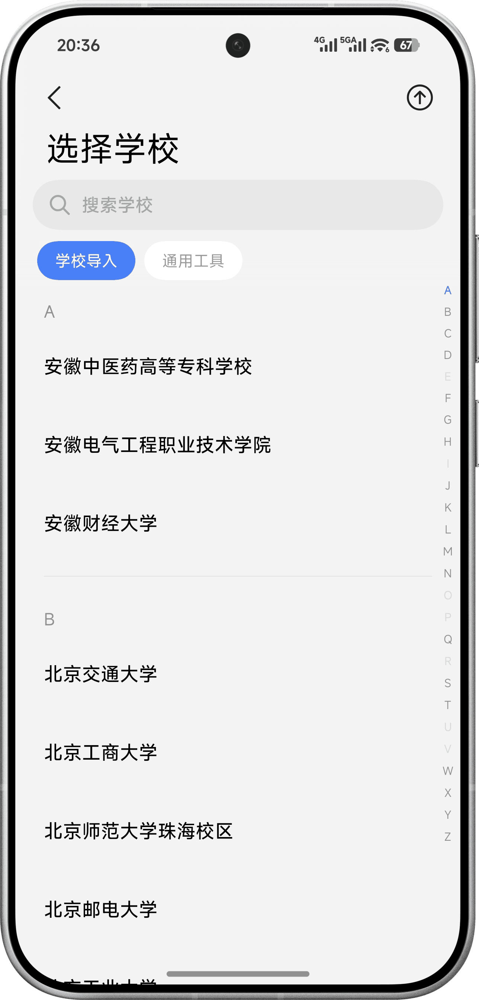
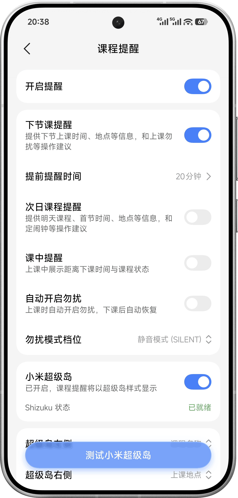
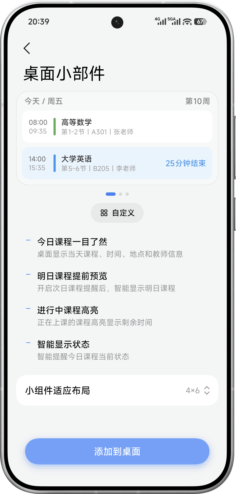

<div align="center">



# Nexio 课程表

**一套课表，两种视图 · 液态玻璃 · 本地优先**

周视图与时间轴随课表切换，外观可逐项调到像素级；数据只存在本机的一个 SQLite 库里，备份走你自己选的本地目录或 WebDAV。

[](https://github.com/HaoZai000/NexioSchedule/stargazers)
[](https://github.com/HaoZai000/NexioSchedule/releases)
[](https://github.com/HaoZai000/NexioSchedule/releases/latest)
[](LICENSE)

**Android 8.0+** · 交流：[QQ 频道](https://pd.qq.com/s/cfwkl5q9q?b=9) / [QQ 群](https://qun.qq.com/universal-share/share?ac=1&authKey=WYfwJ8DnrMhTZKqVb3gcvB6DS2vUReemmQ3e5EnjKFLdErKvpfychIOGHbtG7ZJR&busi_data=eyJncm91cENvZGUiOiIxMDAxNTUxNzQxIiwidG9rZW4iOiJTQnFRNjJqUHlic0p5VVcySDBBSTFJazY0TU1udElDZlp6TjlCa3FXcmFKcjM5YUVxL2hFcktSb1FQcUtTWmt5IiwidWluIjoiNDM5MDg5NzAzIn0%3D&data=sPDFjZgIpm44b9AEDzaKAru_3W-z3w_t3XXP-N6O7DKkCSbdSyyZctJlzKDIbabYcLU7Qv8YeCKaJF_4rJYXtA&svctype=4&tempid=h5_group_info)

</div>

---

## 界面

<div align="center">

| 课程表 | 课表外观 | 添加课程 |
|:---:|:---:|:---:|
|  |  |  |

| 教务导入 | 课程提醒 | 桌面小部件 |
|:---:|:---:|:---:|
|  |  |  |

</div>

---

## 课表与视图

| 能力 | 说明 |
|---|---|
| 周视图 | 每周一页网格，左右翻周，右上角可直接跳转指定周 |
| 时间轴视图 | 把课程按真实起止时间纵向排列，可在外观页里与周视图互相切换；可选「时间轴按真实时长」 |
| 今日页 | 当天课程按上午 / 下午 / 晚上分组，显示未开始 / 正在上课 / 已结束状态，可跳转任意日期 |
| 课程字段 | 课程名、地点、教师、自定义颜色、上课周次（全周 / 单周 / 双周 / 自定义）、备注 |
| 午休与晚休 | 可在卡片上显示午休 / 晚休分界线 |
| 空名课程 | 课程名留空时，课表上统一显示为「特殊课程」 |
| 学期与周次 | 开始上课日期、当前周数、本学期总周数；「智能显示周末」开启后隐藏无课的周六日 |
| 节假日与调休 | 支持节假日 / 调休数据，课表上以「假」「调」角标提示，可影响跳周与今日页文案 |
| 显示非本周课程 | 可选是否显示不属于当前周次的课程 |

## 课表外观

外观页是一个独立的开洞页面：主课表缩进屏幕中央的洞里，改完即时预览，点「应用」才落盘。

| 分类 | 可调项 |
|---|---|
| 视图 | 周视图 / 时间轴视图；时间轴是否按真实时长 |
| 壁纸 | 选择 / 清除壁纸、壁纸亮度、壁纸模糊 |
| 卡片效果 | 卡片着色程度、不透明度、模糊、折射；材质档支持「无材质」「性能优先」 |
| 卡片形状 | 课程卡片高度、圆角、内容对齐方式 |
| 卡片文字 | 文字颜色、文字缩放比例、显示地点、显示教师 |
| 分隔线 | 午休 / 晚休分界线开关 |
| 默认主题 | 跟随应用 / 跟随系统 |

底层用连续曲率圆角（Squircle）裁切，卡片与洞共用同一套轮廓；玻璃部分的模糊、折射、边缘高光由本地 fork 的 backdrop 实现。

## 多课表与排班

- 多课表：新建、编辑、移动、分享、删除；「开启新学期」复用当前课表设置并清空课程
- 课表文件夹：新建 / 移动 / 解散，点击文件夹原地展开折叠
- 排班模式：同时对比多个课表的排班情况，进入后课表页切换为排班视图
- 课表切换有独立的过渡动效

## 导入与导出

| 入口 | 说明 |
|---|---|
| 教务系统导入 | 内置浏览器登入教务系统后执行导入脚本，可切换手机版 / 桌面版页面；导入前选择写入哪张课表 |
| AI 文本导入 | 复制内置提示词给 AI，把返回的文本粘贴进来；解析时一并识别节次配置（上午 / 下午 / 晚上各几节）与上课时间 |
| 文件 / 口令导入 | 支持 JSON、ICS、拾光课程表格式，也支持用口令跨设备导入 |
| 课表导出 | 支持 JSON 与 ICS 两种格式，可单独选择课表并自定义保存位置 |

导入前可选择「增量添加」或「覆盖导入」，并预览「当前课表 N 门 + 新增 M 门 → 共 X 门」。

## 备份与同步

- **本地备份**：全部备份或单独备份某张课表到设备存储，带备份历史列表
- **WebDAV 云备份**：配置后一键备份 / 恢复，可测试连接
- **口令分享**：把课表编码成口令分享给他人，或从口令导入

## 课程提醒

| 类型 | 说明 |
|---|---|
| 下节课提醒 | 提供下节上课时间、地点，以及「上课勿扰」等操作建议，提前量可调 |
| 次日课程提醒 | 明天课程、首节时间、地点，附带「定闹钟」建议 |
| 课中提醒 | 上课中展示距下课时间与课程状态；可选全程显示，或距下课 N 分钟开始显示 |

- 可自动开启勿扰，档位分「完全勿扰 / 静音模式 / 勿扰模式」，下课后自动恢复
- 小米超级岛与灵动岛两种岛区样式，可分别配置左右侧展示内容；关闭后回落为普通实时动态通知

## 桌面小部件

| 小部件 | 形态 |
|---|---|
| 课程预览 | 标准尺寸 / Pad 尺寸 |
| 今日课程 | 标准尺寸 / Pad 尺寸 |
| 今明课程 | 左侧今天、右侧明天 |

设置页内置「添加到桌面」引导：长按桌面空白处 → 小部件 → 找到「Nexio课程表」并添加。

## 设置一览

设置页按四个分区组织，条目与应用内完全一致：

| 分区 | 条目 |
|---|---|
| 基本设置 | 开始上课日期、当前周数、本学期总周数、智能显示周末、显示非本周课程、课程时间管理 |
| 特色功能 | 课程提醒、节假日与调休、桌面小部件、排班模式 |
| 数据管理 | 课表导入、课表导出、课表备份 |
| 其他操作 | 开启新学期、应用偏好设置、更新设置、关于应用 |

平板端为双栏布局，左栏直接列出「学期与周次 / 文件口令导入 / AI 文本导入 / 教务系统导入 / 本地备份 / WebDAV 云同步 / 捐赠支持 / 交流与反馈」等目的地。

## 视觉与动效

- HyperOS 4 风格界面，组件基于 MiUiX
- 液态玻璃：页面级 backdrop 录制 + 模糊 / 折射 / 边缘光，覆盖顶栏、底栏、按钮、下拉菜单与弹窗
- 连续曲率圆角与屏幕圆角裁切；开洞、morph、翻周各有独立时序
- 莫奈取色：页面背景、日期高亮与课程卡片跟随系统壁纸动态配色（Android 12+，可在应用偏好设置中关闭，关闭后恢复课程自定义颜色）
- 主题图标：提供透明单色图标层，支持 Android 13+ 的主题图标启动器

## 技术栈

版本取自 `gradle/libs.versions.toml` 与各模块 `build.gradle.kts`，升级依赖时同步更新：

| 层 | 选型 | 版本 |
|---|---|---|
| 语言 / 构建 | Kotlin / AGP | `2.4.10` / `9.2.1` |
| UI | Jetpack Compose（BOM）+ Material3 | `2026.05.01` / `1.5.0-alpha19` |
| 跨端 | Compose Multiplatform | `1.12.0` |
| 组件库 | [MiUiX](https://github.com/compose-miuix-ui/miuix)（含 Navigation3） | `0.9.4` / `0.9.3` |
| 圆角形状 | [Kyant Shapes](https://github.com/Kyant0/kyant-shapes) | `1.2.1` |
| 本地数据 | SQLDelight（SQLite，单库 `nexio.db`） | `2.3.2` |
| 网络 / 序列化 | OkHttp / Gson | `4.12.0` / `2.11.0` |
| 系统特权 | Shizuku（岛区通知） | `13.1.5` |
| 液态玻璃 | 本地 fork 的 backdrop | — |
| Android SDK | compile / target / min | `37` / `37` / `26` |

## 工程结构

单一仓库，六个 Gradle 模块加一个 Xcode 工程：

```
NexioSchedule/
├── androidApp/     Android 宿主：Activity、桌面小组件、提醒、Shizuku
├── iosApp/         iOS 宿主（Xcode 工程）+ CourseWidget
├── desktopApp/     桌面宿主（Compose Desktop / JVM）
├── ui-shared/      共享 UI：页面、组件、主题、动效、i18n（android + jvm + ios）
├── core/           共享数据层：SQLDelight、仓库、导入导出、WebDAV
├── miuix/          MiUiX 组件的本地扩展
└── backdrop/       液态玻璃（fork）
```

`ui-shared` 与 `core` 的 `commonMain` 里不写平台类型，平台差异走 `expect / actual`；数据只有一份 SQLite 库（`nexio.db`），设置项、课表、课程、作息都在同一个库里。

## 构建

```bash
export JAVA_HOME="/Applications/Android Studio.app/Contents/jbr/Contents/Home"

# Android
./gradlew :androidApp:assembleDebug

# 共享层快检（改 ui-shared / core 时先过这条）
./gradlew :ui-shared:compileKotlinJvm
```

桌面端由 `:desktopApp` 的 Compose Desktop 任务构建，iOS 端用 `iosApp/iosApp.xcodeproj` 打开运行。

## 特别致谢

| 项目 | 作者 |
|---|---|
| [Miuix](https://github.com/compose-miuix-ui/miuix) | Yukonga |
| [Capsule](https://github.com/Kyant0/Capsule) | Kyant0 |
| [OkHttp](https://github.com/square/okhttp) | Square |
| [warehouse](https://github.com/XingHeYuZhuan/shiguang_warehouse) | XingHeYuZhuan |
| [Shizuku](https://github.com/RikkaApps/Shizuku) | RikkaApps |
| [Backdrop](https://github.com/Kyant0/AndroidLiquidGlass) | Kyant0 |

## 开源协议

本项目采用 **[GNU Affero General Public License v3.0](LICENSE)**（AGPL-3.0）开源。

允许自由使用、学习、修改及商业分发；若通过网络向他人提供本应用或修改版，须同时提供完整对应源代码。协议全文见 [LICENSE](LICENSE)，中文摘要与带目录的在线版本见官网 [开源协议页](https://nexioschedule.icu/license.html)。

## 免责声明

本项目按「现状」提供，作者不承担因使用本软件而产生的任何直接或间接损失。请自行评估并遵守 AGPL-3.0 的各项条款。
