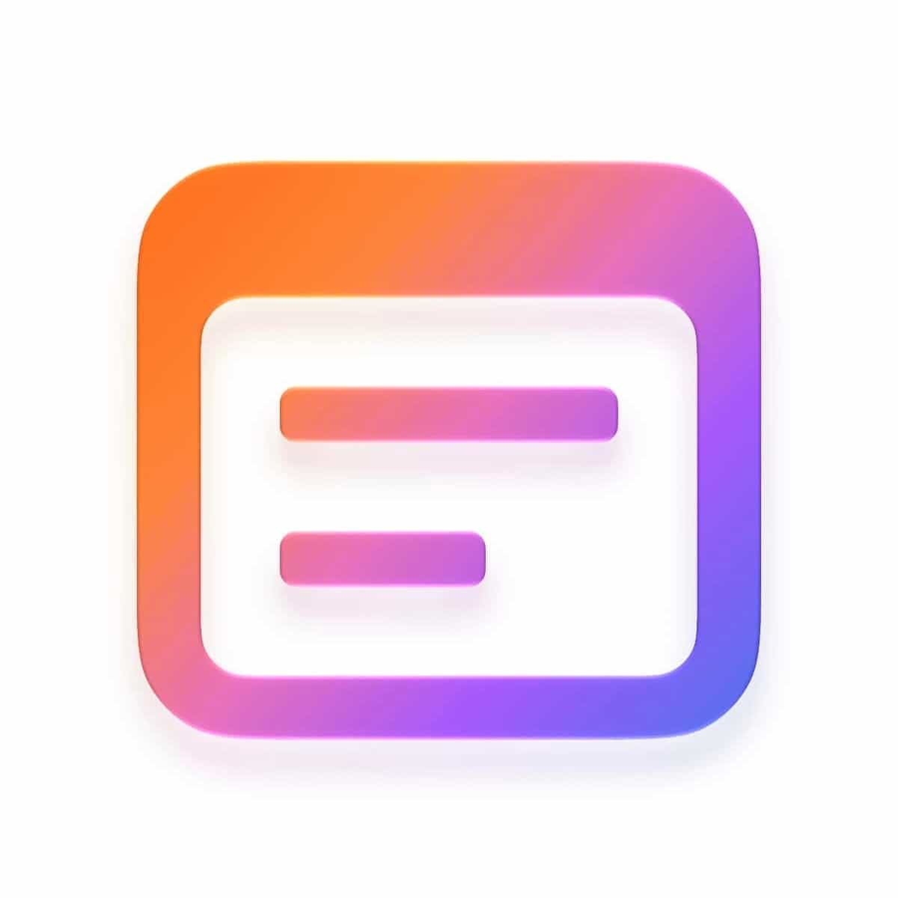
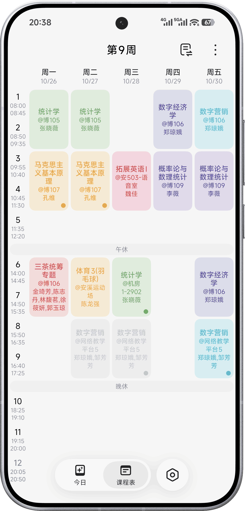
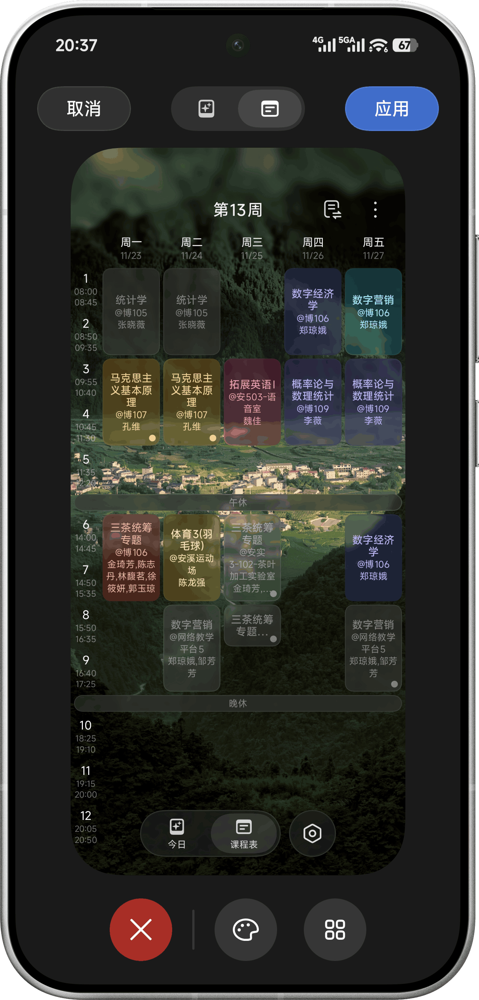
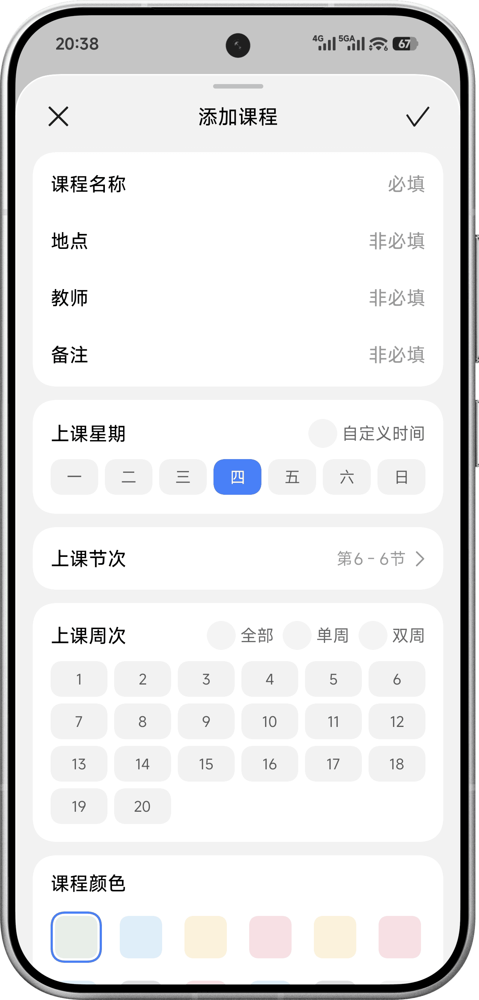
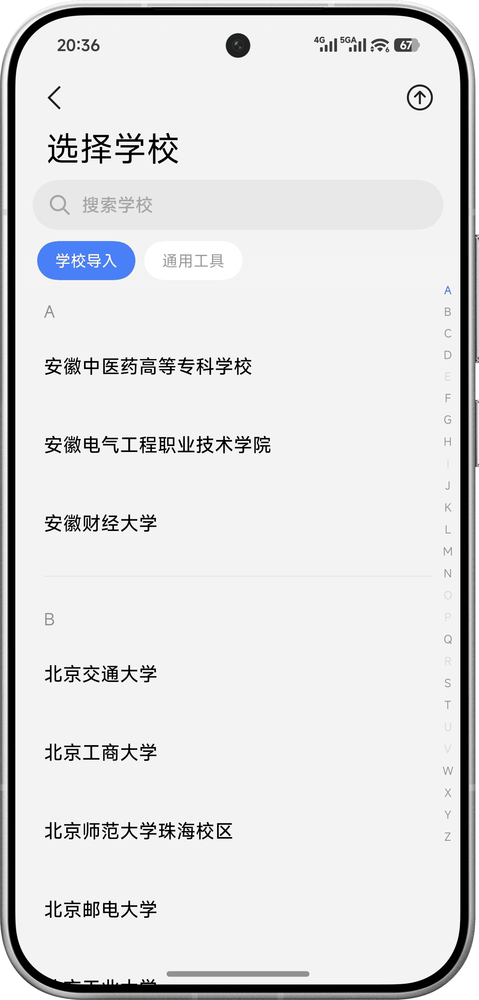
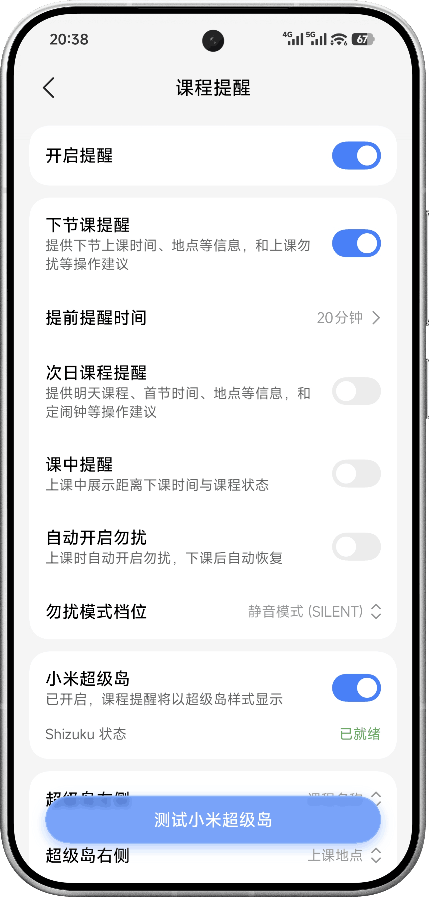
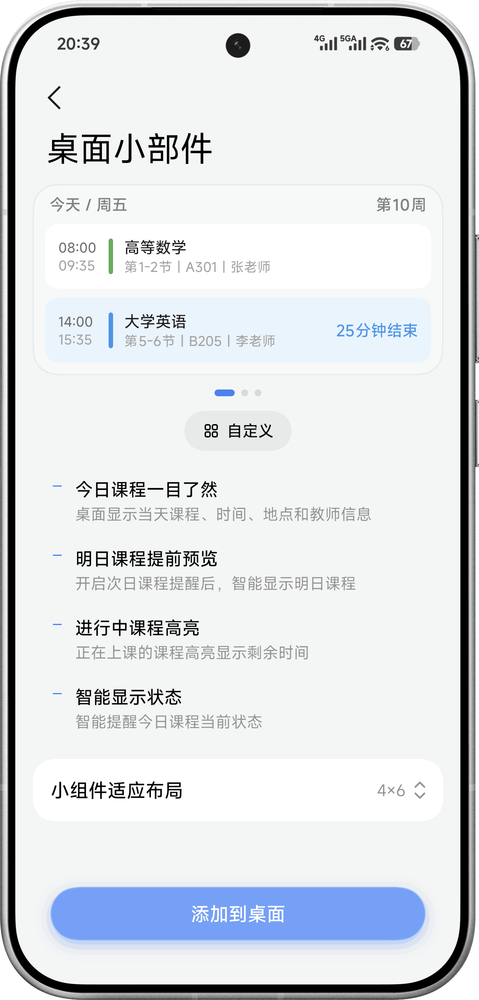

<div align="center">



# Nexio 课程表

**一套课表，两种视图 · 柔光玻璃 · 本地优先**

支持周视图与时间轴视图切换、细粒度课表外观自定义、教务/AI/文件多渠道导入，以及本地与 WebDAV 备份。

[](https://github.com/HaoZai000/NexioSchedule/stargazers)
[](https://github.com/HaoZai000/NexioSchedule/releases)
[](https://github.com/HaoZai000/NexioSchedule/releases/latest)
[](LICENSE)

**Android 8.0+** · 交流：[QQ 频道](https://pd.qq.com/s/cfwkl5q9q?b=9) / [QQ 群](https://qun.qq.com/universal-share/share?ac=1&authKey=WYfwJ8DnrMhTZKqVb3gcvB6DS2vUReemmQ3e5EnjKFLdErKvpfychIOGHbtG7ZJR&busi_data=eyJncm91cENvZGUiOiIxMDAxNTUxNzQxIiwidG9rZW4iOiJTQnFRNjJqUHlic0p5VVcySDBBSTFJazY0TU1udElDZlp6TjlCa3FXcmFKcjM5YUVxL2hFcktSb1FQcUtTWmt5IiwidWluIjoiNDM5MDg5NzAzIn0%3D&data=sPDFjZgIpm44b9AEDzaKAru_3W-z3w_t3XXP-N6O7DKkCSbdSyyZctJlzKDIbabYcLU7Qv8YeCKaJF_4rJYXtA&svctype=4&tempid=h5_group_info)

</div>

---

## 界面预览

<div align="center">

| 课程表 | 课表外观 | 添加课程 |
|:---:|:---:|:---:|
|  |  |  |

| 教务导入 | 课程提醒 | 桌面小部件 |
|:---:|:---:|:---:|
|  |  |  |

</div>

---

## 主要功能

### 课表与视图
- **周视图**：每周一页网格，左右滑动翻周，右上角可直接跳转指定周。
- **时间轴视图**：按课程真实起止时间纵向排列，可在外观页与周视图自由切换，并支持按真实时长缩放。
- **今日页**：按上午 / 下午 / 晚上分组展示当天课程及状态（未开始 / 上课中 / 已结束），支持切换任意日期查看。
- **课程信息**：支持课程名、教室、教师、自定义颜色、上课周次（全周 / 单周 / 双周 / 自定义）与备注；课程名留空时自动显示为「特殊课程」。
- **作息与大课间**：可自定义上午 / 下午 / 晚上节数、每节课时长与课间时长，并支持分别开启上午、下午、晚上的大课间设置；支持快捷批量生成时间表。
- **学期与节假日**：配置开学日期、当前周与总周数，支持「智能显示周末」（自动隐藏无课的周六日）、「显示非本周课程」以及法定节假日/调休角标与教学周重组。

### 课表外观
在外观页可实时预览并在点击「应用」后保存：
- **视图切换**：周视图 / 时间轴视图，时间轴是否按真实时长显示。
- **背景壁纸**：自定义壁纸、调节亮度与模糊度。
- **卡片样式**：调整着色程度、不透明度、模糊、折射与材质档位（柔光玻璃 / 清透磨砂 / 无材质），以及卡片高度、圆角、对齐方式和午休/晚休分界线。
- **文字与主题**：自定义文字颜色、缩放比例、是否显示教室与教师；支持跟随系统深浅色与 Android 12+ 莫奈动态取色。

### 多课表与排班
- **多课表管理**：新建、编辑、移动、分享、删除课表，支持「开启新学期」复用作息设置并清空课程。
- **课表文件夹**：按文件夹分组收纳多张课表，点击原地展开或折叠。
- **排班模式**：同时对比多个课表的排班情况。

### 导入与导出
- **教务系统导入**：内置浏览器登录教务系统后一键运行适配脚本（支持手机版 / 桌面版页面切换）。
- **AI 教务导入 & AI 文本导入**：支持 AI 自动辅助提取教务页课表，或复制提示词让 AI 解析文本并自动识别节次与时间。
- **文件与口令导入**：支持 JSON、ICS、拾光课程表格式及跨设备口令导入；导入前可选择增量添加或覆盖导入，并预览课程数变化。
- **课表导出**：支持将单张课表导出为 JSON 或 ICS 文件。

### 备份、提醒与生态
- **备份与同步**：支持本地全部/单表备份与历史管理，支持 WebDAV 云同步与口令分享。
- **课程提醒**：支持课前提醒、课中进度提醒、次日提醒、上课自动勿扰（下课自动恢复），以及小米超级岛 / 灵动岛与普通实时通知。
- **桌面小部件**：提供「课程预览」「今日课程」「今明课程」等多种尺寸的小部件，支持莫奈取色（长按桌面空白处 → 小部件 → 找到「Nexio课程表」添加）。
- **穿戴与 MCP**：支持将课表同步至手表/手环端，并提供本地 MCP 服务接口供外部工具查询与管理课表。

---

## 本地构建

### 环境要求
- JDK 21+
- Android SDK（需配置 `ANDROID_HOME` 环境变量或项目根目录 `local.properties`）

### 克隆并构建

```bash
git clone https://github.com/HaoZai000/NexioSchedule.git
cd NexioSchedule

# 构建 Android Debug APK
./gradlew :androidApp:assembleDebug

# 构建 Android Release（R8 混淆验证）
./gradlew :androidApp:minifyReleaseWithR8

# 运行共享层测试与 KMP 纯度检查
./gradlew checkKmpPurity :core:check :ui-shared:check

# 编译桌面端（JVM）
./gradlew :desktopApp:compileKotlinJvm
```

iOS 端可使用 Xcode 打开 `iosApp/iosApp.xcodeproj` 进行构建与运行。

> 项目架构、模块划分与开发约定请参阅 [AGENT.md](AGENT.md)。

---

## 特别致谢

| 项目 | 作者 |
|---|---|
| [NexioUI](https://github.com/HaoZai000/NexioUI) | HaoZai000 |
| [SoftGlass](https://github.com/HaoZai000/SoftGlass) | HaoZai000 |
| [Miuix](https://github.com/compose-miuix-ui/miuix) | Yukonga |
| [OkHttp](https://github.com/square/okhttp) | Square |
| [warehouse](https://github.com/XingHeYuZhuan/shiguang_warehouse) | XingHeYuZhuan |
| [Shizuku](https://github.com/RikkaApps/Shizuku) | RikkaApps |

## 开源协议

本项目采用 **[GNU Affero General Public License v3.0](LICENSE)**（AGPL-3.0）开源。协议全文见 [LICENSE](LICENSE)。

## 免责声明

本项目按「现状」提供，作者不承担因使用本软件而产生的任何直接或间接损失。请自行评估并遵守 AGPL-3.0 的各项条款。
